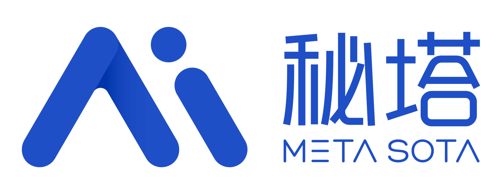
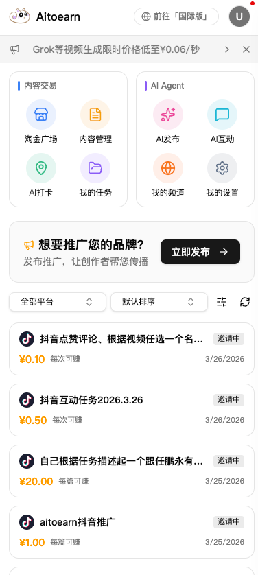
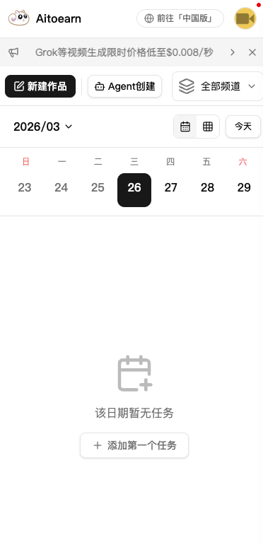
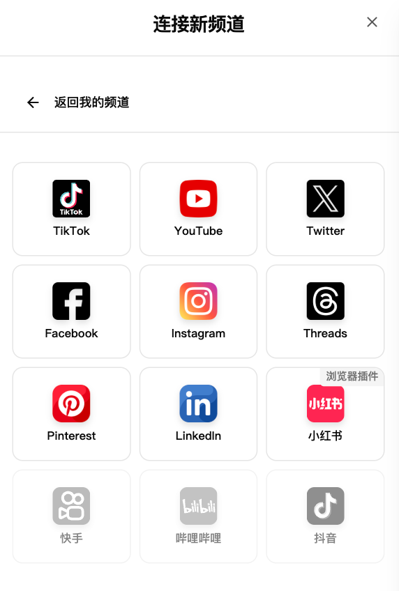

<a href="https://docs.aitoearn.ai/zh/home"></a>

**OPC（一人公司）的 AI 内容营销智能体**

[](https://github.com/yikart/AiToEarn/stargazers)
[](LICENSE)
[](https://nodejs.org/about/releases)
[](https://docs.aitoearn.ai/zh/home)
[](https://trendshift.io/repositories/20785)

简体中文 · [English](README_EN.md) · [日本語](README_JA.md)

**Monetize · Publish · Engage · Create —— 一站式 AI 内容变现平台。**

AiToEarn 通过 AI Agent 自动化，帮助一人公司、创作者、品牌与企业在全球主流平台上构建、分发并变现内容。

- **国内**：抖音 · 小红书 · 快手 · B站 · 视频号 · 公众号
- **海外**：TikTok · YouTube · Facebook · Instagram · Threads · X · Pinterest · LinkedIn

***

## AI 助手技能

除了 MCP 工具，AiToEarn 还配套一套开箱即用的 **Agent 技能包**，覆盖「创作 → 剪辑 → 发布 → 变现」全链路，无需手写复杂提示词。

在你的 AI 助手（Claude Code / Trae / Cursor 等）对话框里直接粘贴下面这段即可安装，AI 会自动索取 API Key、完成配置并验证：

```text
帮我安装 https://github.com/yikart/AiToEarn/tree/main/skills 的插件包
```

各平台的安装方式与详细说明见 [AiToEarn 文档站](https://docs.aitoearn.ai/zh/use/installer-pack)。

***

## 特别感谢 ❤️

<table align="center">
  <tr>
    <td align="center" width="120">
      <a href="https://metaso.cn/minimax-h3/?s=ATE"></a><br>
      <a href="https://metaso.cn/minimax-h3/?s=ATE"><strong>秘塔科技</strong></a>
    </td>
    <td align="left">
      感谢<a href="https://metaso.cn/minimax-h3/?s=ATE">秘塔科技</a>对本项目的赞助！<br>
      <strong>MiniMax H3 视频生成 API｜秘塔科技</strong><br>
      秘塔科技提供高性价比的 MiniMax H3 视频生成服务：<strong>768P 仅 0.09 元/秒，2K 仅 0.15 元/秒</strong>。支持原生 2K、音画同步，API 兼容 <strong>OpenAI 协议</strong>，同时支持 <strong>ComfyUI</strong>，无需自行部署 GPU。<br>
      🎁 通过 <a href="https://metaso.cn/minimax-h3/?s=ATE">AiToEarn专属链接注册</a>，即可领取赠送额度及专属优惠。<br>
      商务对接可加微信：metasota12
    </td>
  </tr>
</table>


## 目录

- [核心功能](#核心功能)
- [快速开始](#快速开始)
- [MCP 集成](#mcp-集成)
- [Docker 部署](#docker-一键部署)
- [最新动态](#最新动态)
- [社区与支持](#社区与支持)
- [推荐项目](#推荐项目)

***

## 核心功能

AiToEarn 围绕内容创作者的完整变现链路，提供四大 Agent 能力：**Monetize · Publish · Engage · Create**。

### 💰 Monetize —— 内容变现

AiToEarn 最核心的目标：帮助每一位创作者赚钱。创作者在平台出售内容以完成商家推广任务，所有结算以结果为导向：

| 模式      | 全称                  | 含义     |
| ------- | ------------------- | ------ |
| **CPS** | Cost Per Sale       | 按成交额结算 |
| **CPE** | Cost Per Engagement | 按互动量结算 |
| **CPM** | Cost Per Mille      | 按播放量结算 |



### 📢 Publish —— 内容发布

一键将内容分发到 14+ 主流平台，告别逐个平台手动发布。统一日历排期，像排日程一样规划所有平台的发布时间。

 

▶ 演示视频：[YouTube — Publish](https://www.youtube.com/watch?v=5041jEKaiU8)

### 💬 Engage —— 内容互动

通过 AiToEarn 浏览器插件，在所有支持平台上实现自动化互动运营：自动点赞、收藏、关注；AI 智能回复评论；挖掘"求链接""怎么购买"等高转化信号；实时监测品牌讨论并主动参与热点。

▶ 演示视频：[YouTube — Engage](https://youtu.be/-QoHNrZBmp0)

### 🎨 Create —— 内容创作

用 Agent 重构内容制作流程。告诉 Agent 你的内容需求，它会自动完成从创意到成品：

- **视频**：自动调用 Grok / Veo / Seedance 等视频模型、视频翻译、视频剪辑
- **图文**：调用 Nano Banana 等顶级图片模型，自动生成高质量图文
- **批量**：批量下发创作任务，Agent 并行生成多条内容，适合矩阵账号与大规模分发

▶ 演示视频：[YouTube — Create](https://youtu.be/y900LxIrZT4)

***

## 快速开始

| 方式                          | 适合人群                         | 需要部署  | 入口                                                                        |
| --------------------------- | ---------------------------- | ----- | ------------------------------------------------------------------------- |
| [① 网页版直接用](#-打开网站直接用)       | 所有用户                         | ❌     | [aitoearn.cn](https://aitoearn.cn/) · [aitoearn.ai](https://aitoearn.ai/) |
| [② MCP 集成](#mcp-集成)         | Claude / Cursor / 任意 AI 助手用户 | ❌     | 见 MCP 集成章节                                                                |
| [③ Docker 部署](#docker-一键部署) | 希望私有化部署的团队                   | ✅ 服务器 | 见下方 3 条命令                                                                 |

### ① 打开网站直接用

无需任何配置，打开浏览器即可使用：

- 🇨🇳 中国用户：[aitoearn.cn](https://aitoearn.cn/)
- 🌍 国际用户：[aitoearn.ai](https://aitoearn.ai/)

不知道第一句话说什么？注册登录后，把下面这段提示词直接粘贴到对话框发送即可（把主题换成你自己的，AI 会自动写文案、配图并发布）：

```text
帮我创作一条关于「周末在家做手冲咖啡」的小红书图文笔记，配 3 张生活感图片，语气轻松真实，写好之后直接发布到我的小红书账号。
```

***

## MCP 集成

> 前置条件：先获取 [API Key](https://docs.aitoearn.ai/zh/use/api-key)（设置 → API Key → 创建）。

AiToEarn 兼容所有支持 MCP 协议的 AI 助手。**根据 API Key 来源选择地址**，环境与 Key 不匹配会导致 `401`：

| 环境  | MCP 地址                                | SSE 地址                                |
| --- | ------------------------------------- | ------------------------------------- |
| 中国版 | `https://aitoearn.cn/api/unified/mcp` | `https://aitoearn.cn/api/unified/sse` |
| 国际版 | `https://aitoearn.ai/api/unified/mcp` | `https://aitoearn.ai/api/unified/sse` |

### Claude Desktop

编辑 `claude_desktop_config.json`，添加：

```json
{
  "mcpServers": {
    "aitoearn": {
      "type": "http",
      "url": "https://aitoearn.ai/api/unified/mcp",
      "headers": {
        "x-api-key": "你的API-Key"
      }
    }
  }
}
```

### Cursor / 其他 AI 助手

在 MCP 设置中填入 **MCP 地址** 与 **认证 Header**（`x-api-key: 你的API-Key`）。完整步骤与各工具截图见 [docs 站 MCP 指南](https://docs.aitoearn.ai/api-reference/post-api-ai-agent-mcp)。

> 💡 自部署用户请将 `aitoearn.ai` 替换为你自己的地址（例如 `localhost:8080`）。

***

## Docker 一键部署

> 前置条件：已安装 [Docker](https://docs.docker.com/get-docker/)。3 条命令搞定，无需手动安装数据库：

```bash
git clone https://github.com/yikart/AiToEarn.git
cd AiToEarn
# 启动前按 DOCKER_DEPLOYMENT_CN.md 配置必填认证密钥，并导出 JWT_SECRET。
docker compose up -d
```

启动后访问 **<http://localhost:8080>**。

**强烈建议配置 Relay**——借用官方凭据完成抖音、小红书、TikTok 等社交平台的 OAuth 授权，无需自行申请开发者账号。Relay、AI 模型服务商、生产环境、存储等完整部署指南见 [Docker 部署文档](https://docs.aitoearn.ai/zh/use/installer)。

***

## 最新动态

| 日期         | 版本                                                                 | 重点                                                     |
| ---------- | ------------------------------------------------------------------ | ------------------------------------------------------ |
| 2026-06-23 | [v2.5](https://github.com/yikart/AiToEarn/releases/tag/v2.5.0)     | Relay 配置改为在配置管理界面中操作，并拆分为 Server Relay 与 AI Relay：Server Relay 用于发布平台授权，AI Relay 用于使用平台提供的 AI 模型；新增开放平台 |
| 2026-05-21 | [v2.4](https://github.com/yikart/AiToEarn/releases/tag/v2.4.0)     | 草稿生成新增支持 HappyHorse 1.0 和 Seedance 2.0，增强视频/图文草稿批量生成、多模型选择、参考图片/视频、目标平台限制与文案提示词；带来全新界面风格，并增强 Twitter/X 探索与互动能力 |
| 2026-03-26 | [v2.1](https://www.aitoearn.ai/)                                   | 内容交易市场上线；新增 MCP 协议支持，可在 Claude、Cursor 等任何支持 MCP 的 Agent 或大模型中使用 AiToEarn |
| 2026-02-07 | [v1.8](https://www.aitoearn.ai/)                                   | 新增线下商户推广解决方案，支持餐厅、零售店、民宿、美容美发、健身房等多种线下业态，将线下推广活动转化为可执行的线上传播任务，通过内容发布与用户参与机制，帮助门店获取更多线上曝光和到店流量 |
| 2025-12-15 | [v1.4.3](https://github.com/yikart/AiToEarn/releases/tag/v1.4.3)   | "All In Agent" 的开始！我们加入了能够自动内容生成和发布，以及一些帮助你操作 AiToEarn 的超级 AI 智能 Agent |
| 2025-11-28 | [v1.4.0](https://github.com/yikart/AiToEarn/releases/tag/v1.4.0)   | 支持应用内自动更新；在创作界面新增大量 AI 功能，例如：缩写、扩写、图片生成、视频生成、标签生成等，并支持 Nano Banana Pro |
| 2025-11-12 | [v1.3.2](https://github.com/yikart/AiToEarn/releases/tag/v1.3.2)   | 首个开源且可完全使用的版本                                            |
| 2025-09-16 | [v1.0.18](https://github.com/yikart/AiToEarn/releases/tag/v1.0.18) | 首个出海版本，新增支持 Facebook、Instagram、Threads、Twitter、YouTube、TikTok、Pinterest |
| 2025-02-26 | [v0.1.1](https://github.com/yikart/AiToEarn/releases/tag/v0.1.1)   | 首个开源版本，初步实现小红书、抖音、快手、视频号一键发布                               |

***

## 社区与支持

遇到使用问题或异常情况，请优先通过 [GitHub Issues](https://github.com/yikart/AiToEarn/issues) 提交反馈，方便统一跟进。

- **Telegram**：[t.me/+447704864210](https://t.me/+447704864210)
- **微信扫码**：见下方二维码
- **贡献指南**：[docs 站贡献指南](https://docs.aitoearn.ai/zh/use/contributing)


***

## 推荐项目

- [AtomGit 托管](https://atomgit.com/yikart/AitoEarn)
- [MuseTalk](https://github.com/TMElyralab/MuseTalk)
- [video\_spider](https://github.com/5ime/video_spider)
- [CosyVoice](https://github.com/FunAudioLLM/CosyVoice?tab=readme-ov-file)
- [facefusion](https://github.com/facefusion/facefusion)
- [NarratoAI](https://github.com/linyqh/NarratoAI)
- [MoneyPrinterTurbo](https://github.com/harry0703/MoneyPrinterTurbo)

***

MIT License · © AiToEarn Team
