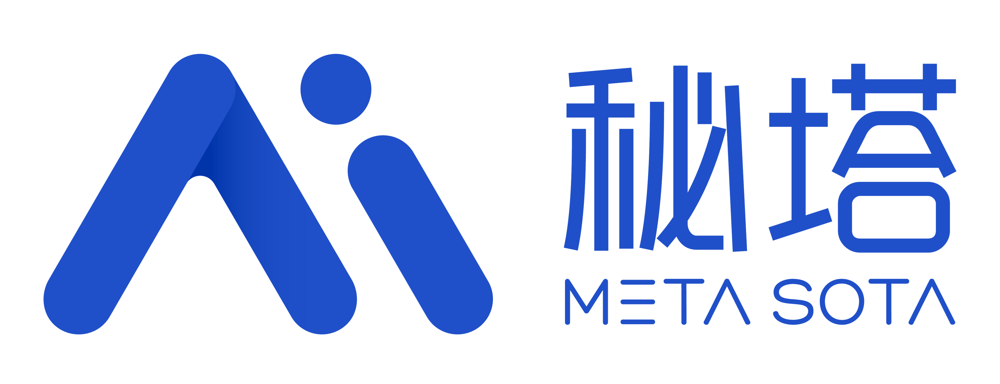
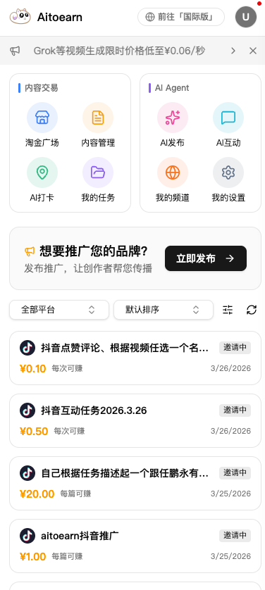
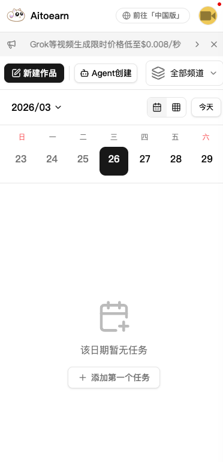
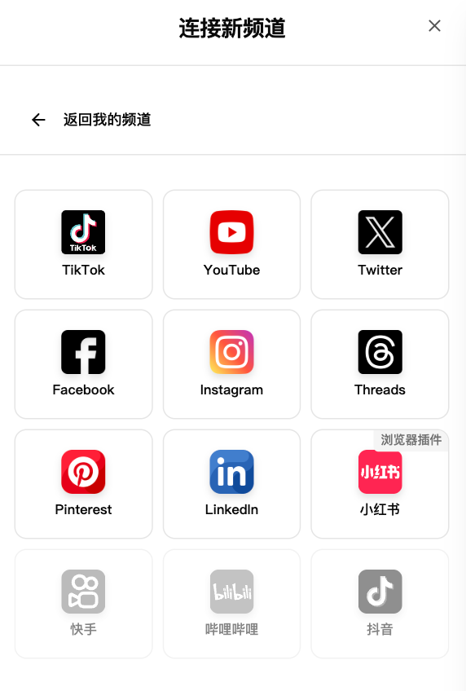

# AiToEarn

**The AI Content Marketing Agent for OPCs (One-Person Companies)**

[](https://github.com/yikart/AiToEarn/stargazers)
[](LICENSE)
[](https://nodejs.org/about/releases)
[](https://docs.aitoearn.ai/en/home)
[](https://trendshift.io/repositories/20785)

[简体中文](README.md) · English · [日本語](README_JA.md)

**Monetize · Publish · Engage · Create — one platform for AI-powered content monetization.**

AiToEarn helps OPCs (One-Person Companies), creators, brands, and businesses build, distribute, and monetize content on the world's leading platforms through AI Agent automation.

- **China**: Douyin · Xiaohongshu (Rednote) · Kuaishou · Bilibili · WeChat Channels · WeChat Official Accounts
- **Global**: TikTok · YouTube · Facebook · Instagram · Threads · X (Twitter) · Pinterest · LinkedIn

---

## Special Thanks

Thanks to [Metaso](https://metaso.cn/minimax-h3/?s=ATE) for sponsoring this project.

[](https://metaso.cn/minimax-h3/?s=ATE)

**MiniMax H3 Video Generation API**: 768P for just RMB 0.09/sec, 2K for just RMB 0.15/sec. Native 2K with synchronized audio and video, OpenAI-compatible API, also supports ComfyUI — no GPU deployment required.

Sign up through the [exclusive AiToEarn link](https://metaso.cn/minimax-h3/?s=ATE) to receive complimentary credits and special offers. For business inquiries, add WeChat: metasota12

---

## Table of Contents

- [Key Features](#key-features)
- [Quick Start](#quick-start)
- [MCP Integration](#mcp-integration)
- [Docker Deployment](#docker-one-click-deploy)
- [What's New](#whats-new)
- [Community & Support](#community--support)
- [Recommended Projects](#recommended-projects)

---

## Key Features

AiToEarn provides four core Agent capabilities around the creator's full monetization pipeline: **Monetize · Publish · Engage · Create**.

### 💰 Monetize — Earn from Your Content

The core mission of AiToEarn: help every creator earn money. Creators sell content on the platform to complete brand promotion tasks. All settlements are results-driven:

| Model | Full Name | Meaning |
|-------|-----------|---------|
| **CPS** | Cost Per Sale | Settle by transaction amount |
| **CPE** | Cost Per Engagement | Settle by engagement count |
| **CPM** | Cost Per Mille | Settle by view count |



### 📢 Publish — Content Publishing

Distribute content to 14+ major platforms with one click — no more manual posting on each platform. Plan and coordinate publishing across all platforms like a calendar.

 

▶ Demo video: [YouTube — Publish](https://www.youtube.com/watch?v=5041jEKaiU8)

### 💬 Engage — Content Engagement

Automate engagement operations across all supported platforms via the AiToEarn browser extension: auto-like, bookmark, and follow; AI-powered smart replies to every comment; comment mining that detects high-conversion signals like "link please" or "how to buy"; real-time brand monitoring with proactive participation in trending conversations.

▶ Demo video: [YouTube — Engage](https://youtu.be/-QoHNrZBmp0)

### 🎨 Create — Content Creation

The content creation workflow is rebuilt around Agents. Tell the Agent what you need and it handles everything from idea to finished product:

- **Video**: Automatically invokes video generation models (Grok, Veo, Seedance, etc.), video translation, and video editing modules
- **Image & Text**: Calls top-tier image models like Nano Banana to produce high-quality visual content
- **Batch**: Submit tasks in bulk — the Agent generates multiple pieces in parallel, perfect for matrix accounts and large-scale distribution

▶ Demo video: [YouTube — Create](https://youtu.be/y900LxIrZT4)

---

## Quick Start

| Option | Best for | Deployment | Entry |
|--------|----------|-----------|-------|
| [① Use the Website](#-use-the-website) | Everyone | ❌ | [aitoearn.cn](https://aitoearn.cn/) · [aitoearn.ai](https://aitoearn.ai/) |
| [② MCP Integration](#mcp-integration) | Claude / Cursor / any AI assistant user | ❌ | See MCP Integration section |
| [③ Docker Deployment](#docker-one-click-deploy) | Teams wanting self-hosted | ✅ Server | 3 commands below |

### ① Use the Website

No setup required — just open your browser:

- 🇨🇳 China users: [aitoearn.cn](https://aitoearn.cn/)
- 🌍 International users: [aitoearn.ai](https://aitoearn.ai/)

---

## MCP Integration

> Prerequisite: get an [API Key](https://docs.aitoearn.ai/en/use/api-key) first (Settings → API Key → Create).

AiToEarn works with any MCP-compatible AI assistant. **Match the URL to your API Key's environment** — a mismatched environment and key returns `401`:

| Environment | MCP URL | SSE URL |
|-------------|---------|---------|
| China | `https://aitoearn.cn/api/unified/mcp` | `https://aitoearn.cn/api/unified/sse` |
| International | `https://aitoearn.ai/api/unified/mcp` | `https://aitoearn.ai/api/unified/sse` |

### Claude Desktop

Edit `claude_desktop_config.json`, add:

```json
{
  "mcpServers": {
    "aitoearn": {
      "type": "http",
      "url": "https://aitoearn.ai/api/unified/mcp",
      "headers": {
        "x-api-key": "your-api-key"
      }
    }
  }
}
```

### Cursor / Other AI Assistants

In your MCP settings, fill in the **MCP URL** and the **Auth Header** (`x-api-key: your-api-key`). Step-by-step instructions with screenshots for each tool are in the [docs MCP guide](https://docs.aitoearn.ai/api-reference/post-api-ai-agent-mcp).

> 💡 For self-hosted instances, replace `aitoearn.ai` with your own address (e.g., `localhost:8080`).

---

## Docker One-Click Deploy

> Prerequisite: [Docker](https://docs.docker.com/get-docker/) installed. 3 commands, no manual database setup:

```bash
git clone https://github.com/yikart/AiToEarn.git
cd AiToEarn
docker compose up -d
```

Open **[http://localhost:8080](http://localhost:8080)** and you're ready to go.

**Strongly recommended: configure Relay** — borrow the official credentials to complete OAuth authorization for Douyin, Xiaohongshu, TikTok, etc., without registering developer accounts on each platform. The full deployment guide (Relay, AI model providers, production config, storage) lives in the [Docker deployment guide](https://docs.aitoearn.ai/en/use/installer).

---

## What's New

| Date | Version | Highlights |
|------|---------|-----------|
| 2026-10-30 | — | Documentation updated |
| 2026-10-29 | — | Removed the bundled Electron desktop client; focused on web and server-side capabilities |
| 2026-06-23 | [v2.5](https://github.com/yikart/AiToEarn/releases/tag/v2.5.0) | Relay split into Server Relay and AI Relay; introduced the Open Platform |
| 2026-05-21 | [v2.4](https://github.com/yikart/AiToEarn/releases/tag/v2.4.0) | Draft generation adds HappyHorse 1.0 and Seedance 2.0; refreshed UI; enhanced Twitter/X exploration and engagement |
| 2026-03-26 | [v2.1](https://www.aitoearn.ai/) | Content marketplace launched; MCP protocol support (Claude / Cursor) |
| 2026-02-07 | [v1.8](https://www.aitoearn.ai/) | Offline merchant promotion (restaurants, retail, B&Bs, beauty salons, gyms) |
| 2025-12-15 | [v1.4.3](https://github.com/yikart/AiToEarn/releases/tag/v1.4.3) | "All In Agent": automatic content generation and publishing |
| 2025-11-28 | [v1.4.0](https://github.com/yikart/AiToEarn/releases/tag/v1.4.0) | In-app auto-update; creation UI gains summarize / expand / image / video / tag generation; Nano Banana Pro support |
| 2025-11-12 | [v1.3.2](https://github.com/yikart/AiToEarn/releases/tag/v1.3.2) | First open-source, fully usable version |
| 2025-09-16 | [v1.0.18](https://github.com/yikart/AiToEarn/releases/tag/v1.0.18) | First international version: FB/IG/Threads/X/YouTube/TikTok/Pinterest |
| 2025-02-26 | [v0.1.1](https://github.com/yikart/AiToEarn/releases/tag/v0.1.1) | First open-source release: one-click publishing to Xiaohongshu / Douyin / Kuaishou / WeChat Channels |

---

## Community & Support

If you run into usage difficulties, questions, or unexpected behavior, please open a [GitHub Issue](https://github.com/yikart/AiToEarn/issues) first so we can track and respond in one place.

- **Telegram**: [t.me/+447704864210](https://t.me/+447704864210)
- **WeChat**: scan the QR code below
- **Contributing Guide**: [docs contributing guide](https://docs.aitoearn.ai/en/use/contributing)


---

## Recommended Projects

- [AtomGit Hosting](https://atomgit.com/yikart/AitoEarn)
- [MuseTalk](https://github.com/TMElyralab/MuseTalk)
- [video_spider](https://github.com/5ime/video_spider)
- [CosyVoice](https://github.com/FunAudioLLM/CosyVoice?tab=readme-ov-file)
- [facefusion](https://github.com/facefusion/facefusion)
- [NarratoAI](https://github.com/linyqh/NarratoAI)
- [MoneyPrinterTurbo](https://github.com/harry0703/MoneyPrinterTurbo)

---

MIT License · © AiToEarn Team
