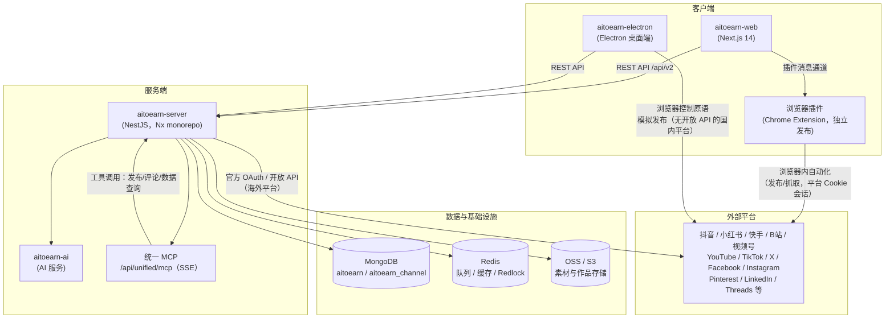

# AiToEarn 架构总览

本文档用一张图说明 web、electron、backend、浏览器插件、MCP 五者的关系。

## 总体架构

## 五者分工

| 组件 | 位置 | 职责 |
|------|------|------|
| Web 前端 | `project/aitoearn-web` | 用户主界面：发布、草稿箱、数据分析、Agent 对话 |
| Electron 桌面端 | `project/aitoearn-electron` | 桌面端发布宿主，通过浏览器控制原语操作国内平台 |
| 浏览器插件 | 独立扩展（web 侧 `src/store/plugin` 负责通信） | 浏览器内平台自动化，复用已登录的网页会话 |
| 后端服务 | `project/aitoearn-backend` | 业务核心：账号绑定、发布编排、任务系统、MCP 三域 |
| MCP | `core/unified-mcp`、`core/channels/mcp`、`core/content` | 把发布/评论/内容能力暴露给外部 Agent |

## 平台接入层（现状）

同一平台的接入逻辑当前有三个宿主实现，正在按 `docs/ecosystem-transformation-plan.md` Phase 2 收敛为统一的 Platform Pack：

| 宿主 | 代码位置 | 说明 |
|------|---------|------|
| Electron | `electron/plat/` | douyin、xhs、Kwai、bilibili、shipinhao |
| 浏览器插件 | `src/store/plugin/plats/` | douyin、xhs |
| 后端 Provider | `core/channels/platforms/` | 13 个平台，海外平台走官方 OAuth |

## 环境区分

- 中国版：`*.aitoearn.cn`，MCP `https://aitoearn.cn/api/unified/mcp`
- 国际版：`* .aitoearn.ai`，MCP `https://aitoearn.ai/api/unified/mcp`
- API Key 与所属环境必须匹配，不匹配会返回 401
